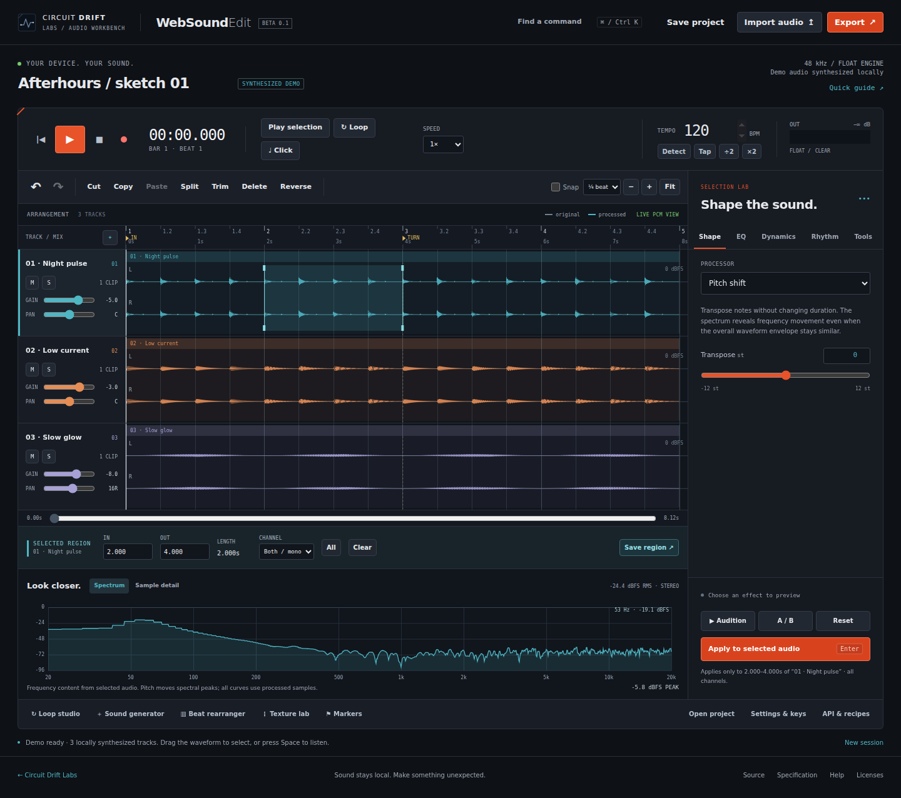

# WebSoundEdit

**A visual multitrack audio workbench by [Circuit Drift Labs](https://djshellshoxxx.github.io/circuitdriftlabs/).**

[Open the editor](https://djshellshoxxx.github.io/websoundedit/) · [Product specification](docs/PRODUCT_SPEC.md) · [API reference](docs/API.md) · [Workflow research](docs/RESEARCH.md) · [Release verification](docs/VERIFICATION.md)

WebSoundEdit is a client-side audio editor and a shared JavaScript audio engine. The website runs on GitHub Pages. Its optional CLI and authenticated loopback HTTP companion let scripts edit local audio with the same implementation. Audio is processed on the user's device.



## What it does

- **Edit a selected sound:** waveform drag selection, exact time inputs, per-channel selection, cut/copy/paste/delete/trim/split, reverse, fades, gain, and undo/redo.
- **Arrange tracks:** multiple tracks and clips, clip movement, duplicate, track gain/pan/mute/solo, markers, snapping and zoom.
- **Shape the audio:** independent pitch shift and time stretch, varispeed, four-band parametric EQ, compressor, lookahead sample-peak limiter, peak normalization, polarity inversion, fractional time alignment, channel swap/mono conversion and DC removal.
- **Find and change rhythm:** BPM detection with confidence and manual/tap/half/double correction; beat-grid offset; metronome; easy selection playback and looping; loop creation with optional join crossfades.
- **Duck or gate:** beat-synchronized volume envelopes, drawn shape nodes, depth and timing controls, compressor mode, and genuine audio-triggered sidechain from another track.
- **Clean up:** silence detection with region inspection and optional silence removal.
- **Make new sounds:** beat slicing/reordering, deterministic granular textures/freeze, and tone/noise/sweep/drum generation. The initial demo is synthesized locally.
- **See the change:** actual processed waveform preview with original overlay, sample detail, FFT spectrum, EQ response and ducking envelope. The display uses the DSP coefficients and real PCM, including mixer gain/panning.
- **Save and automate:** portable project JSON with embedded float PCM, settings JSON, IndexedDB recovery, command palette, a keyboard shortcut for every UI feature, and named API methods for every effect.
- **Record:** explicit microphone recording with processing requests disabled where the device/browser honors them. The microphone is released after recording.

## Formats

WAV export is built in (16/24-bit PCM and 32-bit float). Opus uses a small, dedicated **libopus WASM** encoder at full complexity with Ogg packaging and exact end trimming. MP3, FLAC, Ogg Vorbis, AAC, M4A/AAC, AIFF, ALAC and legacy WMA use a lazily loaded, self-hosted **single-thread FFmpeg WASM** core. The app queries the shipped encoder build before enabling a format. Actual native import support varies by browser; FFmpeg provides a fallback. Opus exports use 48 kHz. The optional Node companion uses an installed native `ffmpeg` binary for non-WAV formats.

Converting lossy audio to a lossless container does not recover discarded information. Integer exports can clip float samples above full scale; 32-bit float WAV preserves headroom. For a file-only conversion, export the clip with **Include track gain and pan** turned off. CLI conversion without a recipe preserves original channels and sample rate.

## Run locally

Requires Node **22.12+** (Node 24 used by CI).

```bash
npm ci
node scripts/prepare-codecs.mjs
npm run dev
```

Open the localhost address printed by Vite. Build the complete self-hosted website:

```bash
npm run build
npm run preview
```

The build includes the conversion core, worker, dependency notices, specifications and API documentation. It does not rely on a third-party CDN. No server is required to serve `dist/`.

## Script a local audio file

```bash
node scripts/cli.mjs \
  --input input.wav \
  --recipe examples/cleanup.json \
  --output edited.flac \
  --save-project session.json
```

Install native FFmpeg separately for formats other than WAV. The CLI never imports the browser-only `ffmpeg.wasm` package.

```bash
npm run api
```

The optional API companion listens on `127.0.0.1:8787` and prints a random bearer token. It accepts audio bytes and JSON commands, not arbitrary client-provided filesystem paths. [Python example](examples/remote-edit.py) · [Direct engine example](examples/direct-engine.mjs) · [Complete API reference](docs/API.md).

GitHub Pages is static hosting. There is **no public REST audio server at the Pages URL**. A script uses the downloaded ES module, local CLI, or optional local HTTP companion. For access from another computer, use your own authenticated tunnel to the local companion; never publish its bearer token. The companion does not automatically control an already-open browser tab: both run the same engine, and project JSON moves sessions between them.

## Browser API

```js
await websoundedit.ready;
const clipId = websoundedit.getState().selectedClipId;
await websoundedit.execute('selection.set', {
  clipId, start: 1, end: 3, channels: 'all'
});
await websoundedit.execute('effect.pitch', { semitones: 3 });
await websoundedit.exportAudio({ scope: 'selection', format: 'flac' });
const project = await websoundedit.saveProject({ download: false });
```

`websoundedit.commands()` discovers core and UI methods. The built `api.js` also exports the DOM-free `AudioEditor` for other websites. See [project format](docs/PROJECT_FORMAT.md) for `f32le-base64` portable PCM and resource validation.

## Editing semantics

- Selection times are **relative to one clip**. Clip placement is absolute project time.
- Effects operate on the selection, or the selected whole clip when no selection exists. Invalid explicit selections are rejected.
- Left/right edits preserve the other channel. Changes to duration or channel layout require all channels.
- Previews do not commit samples or create history. Apply commits one edit. A/B compares original with processed samples. Export renders applied edits.
- Edits inside one clip do not silently move neighboring clips. Overlapping clips mix. Undo/redo retain immutable PCM up to a bounded memory budget.
- Peak normalization and limiting are sample-based. This beta does **not** implement true-peak oversampling or broadcast LUFS normalization.
- Pitch and stretch use WSOLA. Large shifts or difficult transients can have audible artifacts. Supported independent pitch range is ±12 semitones; duration/speed range is 0.5–2×.
- Loop crossfades overlap copies and shorten total duration by each overlap. Use 0 ms for beat-exact repeats and short edge fades when needed.
- Initial safety limits: 10-minute timeline, 256 MiB decoded PCM/project/render budgets, 64 tracks, 512 clips, 30 undo entries (also memory bounded), and 192 MiB browser codec input. Device memory may require shorter sessions.

## Ergonomics and shortcuts

Transport, selection, cut/split/trim, undo, zoom, and loop controls are adjacent to the waveform. Effects occupy one selection-focused inspector. Complex parameters remain editable by keyboard. Ctrl K opens the searchable command palette; Settings lets every shortcut be reassigned and exported as JSON.

The control hierarchy is an inference from documented Audacity and Ableton workflows, **not** a claim that public usage-frequency telemetry exists. [Research and primary sources](docs/RESEARCH.md).

| Action | Default shortcut |
| --- | --- |
| Play / pause | Space |
| Play selection | Shift Space |
| Loop / metronome | L / M |
| Split / fit / selection zoom | S / F / Z |
| Undo / redo | Ctrl Z / Ctrl Shift Z |
| Import / export | Ctrl O / Ctrl E |
| Save selection | Ctrl Shift E |
| Save / open project | Ctrl S / Ctrl Shift O |
| Pitch / stretch / EQ / ducking | E P / E T / E Q / E D (sequential keys) |
| Every feature | Ctrl K, or its configurable shortcut |

On macOS, Command substitutes for Control. Audio remains silent until playback or recording is explicitly requested.

## Verification and publishing

```bash
npm test
npm run build
npx playwright install chromium
npm run test:e2e
```

The GitHub Actions workflow runs measurable DSP, state, API and browser tests before deploying `dist/`. Browser results and screenshots are retained as an artifact. Enable repository **Settings → Pages → Source: GitHub Actions** once. That site-administration setting cannot be created by the workflow's default `GITHUB_TOKEN`; see [GitHub's configure-pages action](https://github.com/actions/configure-pages/blob/main/action.yml).

The detailed test plan is in [ACCEPTANCE.md](docs/ACCEPTANCE.md). See workflow run results for the current verified commit; the existence of a test case is not a claim that an untested browser supports it.

## Dependencies and brand

See [THIRD_PARTY.md](docs/THIRD_PARTY.md) for SoundTouch, FFmpeg and codec notices and corresponding upstream source. The application distributes the unmodified single-thread FFmpeg core separately from its wrapper; upstream licenses apply. Circuit Drift Labs' palette and mark follow its existing [visual identity](https://github.com/djshellshoxxx/circuitdriftlabs/blob/main/theme.md).
